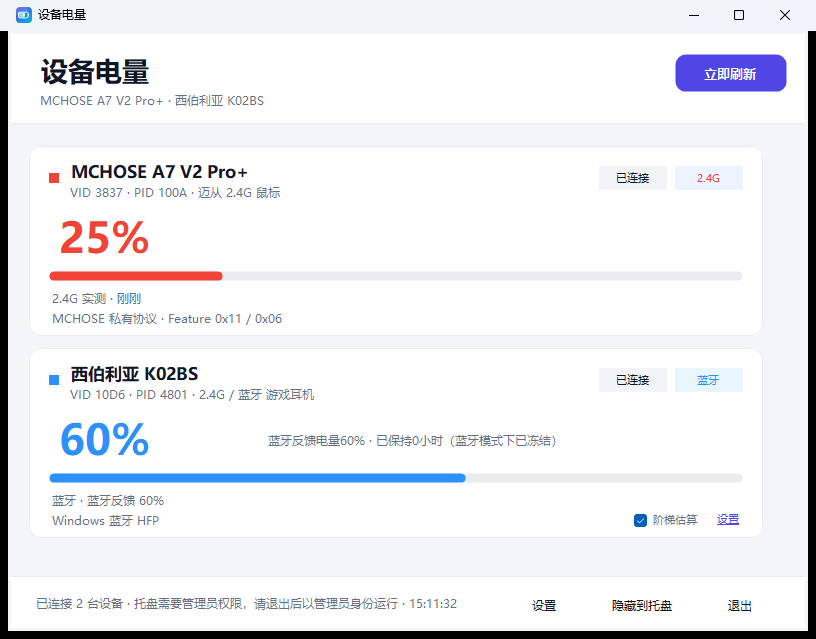
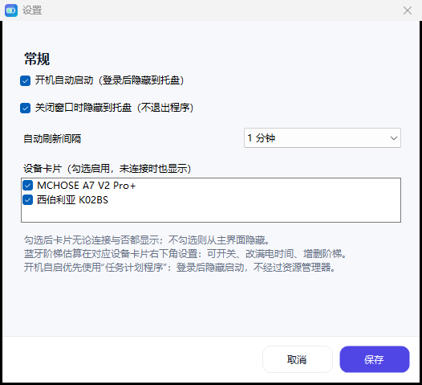

# 设备电量（Wireless Battery）v1.3

Windows 本地外设电量工具。支持 2.4G / 蓝牙双模，蓝牙阶梯电量带“上报值校验 + 时间推算”，
MCHOSE A7 V2 Pro+ 实测，西伯利亚 K02BS 双模 + 蓝牙阶梯。

- 无第三方依赖，不联网、不写日志
- 800×600 圆角扁平界面；关闭窗口默认隐藏到托盘
- 托盘按设备显示数字：鼠标绿色、耳机蓝色、低于 30% 红色
- 设备断开后保留最后一次电量，并显示“未连接”



## 主要功能

### 1. 双模识别

同一张卡片自动显示 `2.4G` / `蓝牙` / `双模`，右上角另有一个连接状态徽标：
**已连接**（黑字）/ **未连接**（灰字）。短暂断连有 10 秒冗余，超过 10 秒才正式标记未连接；
期间若恢复则继续显示“已连接”。

- **MCHOSE A7 V2 Pro+**：Feature Report `0x11 / 0x06`，实测电量。
  启动时如果第一轮 HID 读取较慢或失败，会先显示上一次保存的电量卡片。
- **西伯利亚 K02BS**：
  - 2.4G 是否连接用 Windows 音频端点真实状态判断（不是接收器插入时间）。
  - 蓝牙 HFP 上报的是阶梯值（实测 40%，常见 0/20/40/60/80/100）。
  - 2.4G + 蓝牙同时连接时显示“双模”，使用蓝牙阶梯。
- **2.4G 不做电量估算**：没有蓝牙电量时只显示最后一次读数 / “等待蓝牙电量”。

### 2. 蓝牙阶梯：自动校验 + 时间推算

K02BS（以及其他蓝牙设备）卡片右下角有：

- `阶梯估算` 开关：开关该设备的估算。
- `设置`：打开该设备的估算设置，可自定义：
  - 满电使用时间（小时）
  - 阶梯数量和每个阶梯数值（逗号分隔，例如 `100,80,60,40,20,0`）
  - 恢复默认

规则（v1.3 调整）：

1. **自动校验**：蓝牙上报值必须正好等于某个已配置阶梯。
   例如阶梯是 `100,80,60,40,20,0`，蓝牙上报 `40` 正常；
   如果上报 `45`，卡片会显示 **“阶梯估算设置有误”**，并说明 `45` 不在阶梯列表中。
   修改设置后下一次刷新会自动重新校验。
2. **主数字显示时间推算值**：以当前蓝牙阶梯为锚点，按满电时间向下一档补间；
   补间最低只到下一档，不会继续往下掉。
3. **小字显示反馈与保持时间**：例如 `蓝牙反馈电量40% · 已保持10小时`。
   主数字会随刷新间隔/“立即刷新”更新，卡片原地刷新，不需要重开窗口。
4. 蓝牙上报到新阶梯时重新计时；上报值不在阶梯中时仍提示“阶梯估算设置有误”。
5. K02BS 进入“仅蓝牙”模式后**不再补读，也不再把无反馈判为未连接**；
   只冻结“已保持”时间，提示变为 `已保持0小时（蓝牙模式下已冻结）`。
   重新进入“双模”后 3 秒补读一次；阶梯变化才重置保持时间，未变化则从冻结处继续。

设置界面会显示“当前蓝牙上报：40%（是否已包含在阶梯中）”，保存前也能看到校验结果。

### 3. 断开保留最后电量

- MCHOSE 休眠/无响应：保留最后一次读数，徽标变“未连接”，状态行显示“未连接 · 最后电量”。
- K02BS 关机/断开：同样保留最后一次电量。
- 托盘图标保留最后数字，tooltip 加“（未连接）”。
- 重新读取成功后自动恢复。

### 4. 自动启动（默认开启）

- 首选 **任务计划程序**：任务使用 `HighestAvailable`，登录后直接启动
  `WirelessBattery.exe --tray`，不经过资源管理器，可避开 SmartScreen。
- 计划任务失败时，依次退回“启动”文件夹快捷方式、隐藏 `.vbs`、`HKCU\...\Run`。
- 启动后隐藏到托盘；如果系统暂时不允许托盘，会重试约 30 秒，仍失败则最小化到任务栏。
- 移动 exe 后，到设置里重新勾选保存即可更新任务路径。

设置里：开机自启、关闭到托盘、刷新间隔，以及**设备卡片勾选列表**（勾选后即使未连接也显示）。
**没有**“重置 K02BS 阶梯计时”。

### 5. 托盘

- 一个主图标（显示第一台有电量设备的数字）+ 每台设备一个数字图标。
- 鼠标绿色、耳机蓝色，**电量 < 30% 红色**；阶梯设置有误的对应设备图标变琥珀色。
- 双击打开主界面；右键可刷新/设置/退出。
- 关闭窗口默认只隐藏，不退出。
- Windows 11 默认把新图标放进 `^` 溢出区；点 `^` 展开，
  或到“设置 → 个性化 → 任务栏 → 其他系统托盘图标”里打开“设备电量”。
  Windows 不允许应用强制把图标钉在窄任务栏上；把图标从 `^` 拖到任务栏即可常驻。

#### 如果托盘一直显示“需要管理员权限”

这是权限倒挂，不是图标被隐藏：**Explorer 以管理员（High）运行，而程序是普通（Medium）权限**。
Windows 的 UIPI 会阻止 Medium 程序向 High Explorer 注册 `Shell_NotifyIcon`，所以托盘探测失败。

处理方式（任选一种）：

1. 运行 [`以管理员身份运行.bat`](以管理员身份运行.bat)：结束旧实例，再以管理员权限重启。
2. 右键 `WirelessBattery.exe` → “以管理员身份运行”。
3. 退出程序，重新启动；程序检测到托盘失败且当前用户是管理员时，会主动弹 UAC 申请提权。

以管理员运行后，状态栏会变成“托盘图标已就绪”，图标通常在 `^` 里。



### 6. SmartScreen

未签名的 exe 无法保证 100% 不提示。已做：

- `app.manifest`：`asInvoker`、Windows 10/11 兼容、DPI 感知；
- 版本信息、新图标；
- [`启动（无警告）.lnk`](启动（无警告）.lnk) / `bin/打开设备电量.lnk`：
  快捷方式指向系统 `cmd.exe`，由 [`启动设备电量.cmd`](bin/启动设备电量.cmd) 先
  `Unblock-File` 再 `start`，不会直接对带“网络来源”标记的 exe 调用 ShellExecute；
- [`解除锁定并启动.bat`](解除锁定并启动.bat)：同样的先解除锁定再启动；
- 自动启动使用计划任务调用同一个 `.cmd`，因此登录启动也不会经过资源管理器。

如果仍然直接双击 `WirelessBattery.exe` 被拦：点“更多信息 → 仍要运行”一次，
或改用上面的快捷方式/批处理。想彻底消除需要购买代码签名证书（EV 最好）。

## 快速开始

1. 双击 [`启动（无警告）.lnk`](启动（无警告）.lnk)；或运行 [`解除锁定并启动.bat`](解除锁定并启动.bat)。
   如果状态栏显示“托盘需要管理员权限”，改用 [`以管理员身份运行.bat`](以管理员身份运行.bat)。
2. 插接收器、开设备；关闭窗口后仍在托盘。
3. K02BS 卡片右下角开关/设置阶梯估算。
4. 设置里可以勾选要显示的设备卡片；另有自启、关闭到托盘、刷新间隔。

## 支持情况

| 设备 | 状态 | 电量来源 |
|---|---|---|
| **MCHOSE A7 V2 Pro+**（`3837:100A`） | ✅ 实测 | Feature `0x11 / 0x06` |
| MCHOSE A7 V2 / A7 / AX5 / L7 / M7 | ✅ 理论可用 | 同一套 Classic Feature 协议 |
| MCHOSE V2（A5 V3 / K7 V2 等） | ✅ 自动尝试 | `0x4D / 0x0900` |
| **西伯利亚 K02BS**（`10D6:4801`） | ✅ 双模 | 蓝牙 HFP 阶梯 + 校验/时间推算；2.4G 只做连接状态 |
| 标准 HID 电量设备 | ✅ 自动尝试 | `0x0006/0x0020` |
| 罗技 HID++ 2.0 | ✅ 自动尝试 | `0x1004 / 0x1000` |
| 杰理（Jieli）2.4G 耳机 | ✅ 自动尝试 | `0xFF02` TLV `0x01` |

### K02BS 2.4G 连接判定（实测）

接收器 HID 接口：`0x000C`、`0x000B`、`0xFF90`、`0xFF82`。
`0xFF90` 固定返回 `AC F8`，开关机/充电都不变；Windows 音频端点会随真实链路变化：

```
耳机(3) state=1 -> 8 -> 1
耳机(5) state=1 -> 8 -> 1
```

程序只认 `formfactor=3/5` 端点的 `(DeviceState & 0x0F) == 1`；
`formfactor=1` 的“扬声器”端点一直 active，不能作为连接依据。

## 文件

```
bin/WirelessBattery.exe       主程序（v1.3）
bin/无线设备电量.exe          中文名副本
bin/启动设备电量.cmd          先解除锁定再启动的脚本（快捷方式使用）
bin/打开设备电量.lnk          无 SmartScreen 的直接启动快捷方式
启动（无警告）.lnk            根目录快捷方式（指向上面的启动脚本）
以管理员身份运行.bat          结束旧实例并以管理员权限重启（修复托盘）
解除锁定并启动.bat            首次运行/解除下载锁定
启动.bat                      普通启动
settings.ini                  首次运行后生成（便携设置/计时）
src/                          源码
assets/app.ico                新图标（多尺寸）
tools/make-icon.ps1           重新生成图标
build.ps1                     重新编译（Windows 自带 csc，不需要 SDK）
docs/screenshot.png           主界面
docs/settings.png             设置界面
```

## 重新编译

```powershell
powershell -ExecutionPolicy Bypass -File build.ps1
```

需要 Windows 自带的 .NET Framework 4.x。重新生成图标：

```powershell
powershell -ExecutionPolicy Bypass -File tools/make-icon.ps1
```

## 隐私

不联网、不写日志、不上传数据。`--once` 仅调试用，会生成 `scan.txt`；`--settings` 启动时打开设置。

## 免责声明

个人工具，与 MCHOSE（迈从）、XIBERIA（西伯利亚）无隶属或授权关系。
